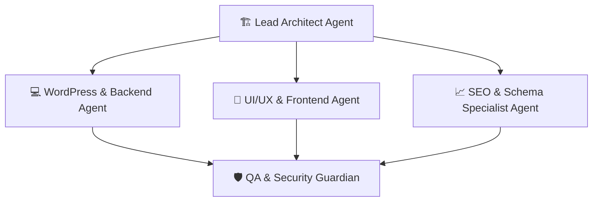

# 🤖 AGENTS.md — Protocolo de Agentes para Blog de Recetas de Cocina (WordPress)

Este documento define la arquitectura de agentes, roles de especialización, estándares de ingeniería y protocolos de calidad para el desarrollo y mantenimiento del blog de recetas de cocina en WordPress.

---

## 🎯 1. Misión del Proyecto

Desarrollar un blog de recetas de cocina de alto rendimiento, accesible y optimizado para motores de búsqueda (SEO) y lectores humanos, combinando:
1. **Schema Markup (`Recipe` de Schema.org)** impecable para Google Rich Cards.
2. **Experiencia de usuario (UX) centrada en la cocina**: modo cocina (pantalla siempre activa), escalador de porciones, conversión de unidades y versión para imprimir sin distracciones.
3. **Core Web Vitals de primer nivel**: LCP < 1.5s, imágenes en WebP/AVIF y CSS modular sin sobrecarga de constructores pesados.

---

## 👥 2. Matriz de Roles de Agentes

Cada agente asume responsabilidades estrictas según el dominio de la tarea:



### 1. 🏗️ Lead Architect Agent
* **Responsabilidad:** Gobernanza del proyecto, diseño de la base de datos (tablas personalizadas vs. CPT/postmeta) y decisiones de dependencias.
* **Regla de oro:** Minimizar el uso de plugins innecesarios. Preferir funciones nativas de WordPress (`register_post_type`, Block Hooks, Theme JSON) antes que añadir plugins que añadan bloat.

### 2. 💻 WordPress & Backend Agent
* **Responsabilidad:** Desarrollo de Custom Post Types (`receta`), taxonomías personalizadas (Dificultad, Cocina/Región, Dieta, Temporada), endpoints REST API y lógica PHP.
* **Estándar:** Cumplimiento estricto de [WordPress Coding Standards (WPCS)](https://developer.wordpress.org/coding-standards/wordpress-coding-standards/php/). Sanitización de entrada (`sanitize_text_field`, `absint`) y escapado de salida (`esc_html`, `esc_attr`, `esc_url`).

### 3. 🎨 UI/UX & Frontend Agent
* **Responsabilidad:** Componentes de bloques Gutenberg, interactividad moderna (Interactivity API de WordPress), estilos de impresión (`@media print`) y accesibilidad (WCAG 2.1 AA).
* **Funcionalidad clave:** Botón "Saltar a la receta" (*Jump to Recipe*), checkboxes para tachar ingredientes completados y temporizadores de cocción.

### 4. 📈 SEO & Schema Specialist Agent
* **Responsabilidad:** Estructurar datos JSON-LD con la especificación `Schema.org/Recipe`.
* **Métricas clave:** Validar que cada receta incluya obligatoriamente: `name`, `image`, `recipeIngredient`, `recipeInstructions`, `prepTime`, `cookTime`, `recipeYield`, `nutrition` y `author`.

### 5. 🛡️ QA & Security Guardian
* **Responsabilidad:** Auditoría de nonces en peticiones AJAX/REST, control de capacidades (`current_user_can`), validación de tipos de archivo en subidas de multimedia y tests de rendimiento.

---

## 📐 3. Principios de Arquitectura y Buenas Prácticas

### A. Estructura de Datos para Recetas
No almacenar los ingredientes e instrucciones como un simple bloque de texto sin procesar. Utilizar campos estructurados:
* **Custom Post Type:** `receta`
* **Campos estructurados (Meta Fields):**
  * `_receta_tiempo_preparacion` (en formato ISO 8601: ej. `PT20M`)
  * `_receta_tiempo_coccion` (ej. `PT45M`)
  * `_receta_porciones` (entero)
  * `_receta_dificultad` (Fácil, Media, Avanzada)
  * `_receta_ingredientes` (Array JSON con cantidad, unidad e ingrediente)
  * `_receta_pasos` (Array JSON ordenado de pasos con imagen opcional)
  * `_receta_calorias` (entero)

### B. Seguridad en WordPress
1. **Nonces obligatorios:** Toda llamada de formulario o endpoint que modifique estado debe validar `check_admin_referer()` o `wp_verify_nonce()`.
2. **Capacidades:** Comprobar siempre `current_user_can('edit_posts')` antes de ejecutar mutaciones.
3. **Escapado tardío:** Escapar las variables en el momento exacto en que se imprimen en el HTML, nunca antes:
   ```php
   // Bien
   echo esc_html( $ingrediente['nombre'] );
   
   // Mal
   $nombre = esc_html( $ingrediente['nombre'] );
   echo $nombre;
   ```

### C. Rendimiento y Media
1. Las imágenes de recetas deben generarse automáticamente en formatos modernos (WebP/AVIF).
2. Generar tamaños específicos para la tarjeta de receta: miniatura 1:1 (cuadrada), feed 4:3 y cabecera 16:9.
3. El CSS de impresión debe eliminar menús, pies de página, comentarios y barras laterales para permitir imprimir en una sola hoja.

---

## 🚦 4. Flujo de Trabajo para Nuevas Funcionalidades

1. **Definición:** El agente revisa `tasks.md` y toma una tarea en estado `[ ]`.
2. **Implementación:** Código modular en un plugin de funcionalidad propio (`wp-content/plugins/recetas-core/`) o en un tema hijo/Block Theme (`wp-content/themes/recetas-theme/`).
3. **Verificación:**
   * Validar sintaxis PHP: `php -l archivo.php`.
   * Probar con `wp-cli` los cambios en base de datos.
   * Comprobar el validador de Schema de Google: [Schema Markup Validator](https://validator.schema.org/).
4. **Cierre:** Marcar la tarea en `tasks.md` como `[x]` con nota de resolución.
