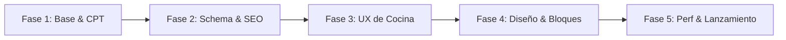

# 📋 tasks.md — Plan de Trabajo y Backlog del Blog de Recetas

Este documento gestiona las fases de desarrollo, tareas pendientes, criterios de aceptación y prioridades para la construcción del blog de recetas de cocina.

---

## 🧭 Fases del Proyecto

---

## 📌 Fase 1: Arquitectura Base y Tipo de Contenido (CPT)

- [ ] **1.1 Crear Plugin de Funcionalidades Base (`recetas-core`)**
  - [ ] Crear estructura en `wp-content/plugins/recetas-core/`
  - [ ] Añadir cabecera estándar de plugin con soporte de traducción
  - [ ] *Criterio de aceptación:* El plugin se puede activar y desactivar limpiamente con `wp plugin activate recetas-core`.

- [ ] **1.2 Registrar Custom Post Type `receta`**
  - [ ] Configurar slug `/recetas/`
  - [ ] Asignar icono de menú Dashicons (`dashicons-food`)
  - [ ] Habilitar soporte para Gutenberg (`show_in_rest = true`)
  - [ ] *Criterio de aceptación:* Se puede crear, editar y previsualizar una receta desde `/wp-admin/post-new.php?post_type=receta`.

- [ ] **1.3 Registrar Taxonomías Gastronómicas**
  - [ ] Taxonomía `tipo_cocina` (Italiana, Mexicana, Mediterránea, etc.)
  - [ ] Taxonomía `categoria_plato` (Postres, Aperitivos, Platos Principales)
  - [ ] Taxonomía `dieta` (Vegano, Vegetariano, Sin Gluten, Keto, Bajo en Calorías)
  - [ ] Taxonomía `dificultad` (Fácil, Intermedia, Difícil)
  - [ ] *Criterio de aceptación:* Las 4 taxonomías aparecen accesibles en la barra lateral del editor de recetas.

---

## 📈 Fase 2: Schema.org y SEO Gastronómico

- [ ] **2.1 Implementación de Schema JSON-LD para Recetas**
  - [ ] Inyectar bloque `<script type="application/ld+json">` en el hook `wp_head` de recetas
  - [ ] Validar mapeo de tiempos a formato ISO 8601 (`PTxxM`)
  - [ ] Mapear autor, fecha de publicación, imagen destacada e ingredientes
  - [ ] *Criterio de aceptación:* La URL de la receta pasa sin errores ni advertencias en el [Validador de Resultados Enriquecidos de Google](https://search.google.com/test/rich-results).

- [ ] **2.2 Optimización de Metadatos y OpenGraph**
  - [ ] Tarjetas de Twitter (Large Image) y etiquetas OpenGraph automáticas
  - [ ] Generación automática de extractos optimizados para snippets

---

## 🍳 Fase 3: Experiencia de Usuario en Cocina (UX)

- [ ] **3.1 Botón "Saltar a la Receta" (*Jump to Recipe*)**
  - [ ] Botón accesible al inicio de cada artículo que hace scroll suave directo a la tarjeta de ingredientes y preparación.
  - [ ] *Criterio de aceptación:* Funciona con teclado (tecla Tab) y ratón con animación fluida.

- [ ] **3.2 Lista Interactiva de Ingredientes**
  - [ ] Checkboxes que permitan al usuario marcar los ingredientes que ya tiene listos o que ya ha añadido a la olla.
  - [ ] Almacenar estado temporalmente en `localStorage` para no perderlo al refrescar.

- [ ] **3.3 Calculadora / Escalador Dinámico de Porciones**
  - [ ] Selector numérico de porciones (+ y -) que recalcula automáticamente las cantidades de los ingredientes en tiempo real mediante JavaScript ligero.

- [ ] **3.4 Modo Cocina (Pantalla Siempre Encendida)**
  - [ ] Botón de activación con la API `navigator.wakeLock`.
  - [ ] Indicador visual cuando el modo cocina está activo.

- [ ] **3.5 Estilos de Impresión Optimizados (`@media print`)**
  - [ ] Ocultar cabeceras, menús, comentarios y anuncios al imprimir.
  - [ ] Formatear ingredientes y pasos en columnas legibles para 1 sola hoja de papel.

---

## 🎨 Fase 4: Diseño, Bloques y Plantillas

- [ ] **4.1 Tarjeta Visual de Receta (Recipe Card Block)**
  - [ ] Bloque nativo o plantilla para mostrar la ficha técnica (tiempo preparación, cocción, raciones, calorías).
  - [ ] Diseño adaptable para dispositivos móviles.

- [ ] **4.2 Plantilla de Archivo de Recetas (`archive-receta.html` o `archive-receta.php`)**
  - [ ] Grid visual con tarjetas de recetas, tiempo de cocción e icono de dificultad.
  - [ ] Filtro rápido por tipo de cocina y dieta.

---

## ⚡ Fase 5: Rendimiento, Seguridad y Lanzamiento

- [ ] **5.1 Optimización de Medios (Imágenes de Comida)**
  - [ ] Activar compresión y conversión automática a WebP.
  - [ ] Definir atributos `srcset` y `loading="lazy"` para todas las imágenes de recetas.
  - [ ] Evitar saltos de diseño (CLS) especificando siempre `width` y `height`.

- [ ] **5.2 Auditoría de Seguridad y Permisos**
  - [ ] Verificar sanitización de todos los metacampos guardados.
  - [ ] Asegurar que los endpoints REST solo admiten usuarios autenticados para mutaciones.

- [ ] **5.3 Pruebas de Core Web Vitals**
  - [ ] Largest Contentful Paint (LCP) < 1.8 segundos.
  - [ ] Cumulative Layout Shift (CLS) < 0.1.
  - [ ] Interaction to Next Paint (INP) < 200 ms.
